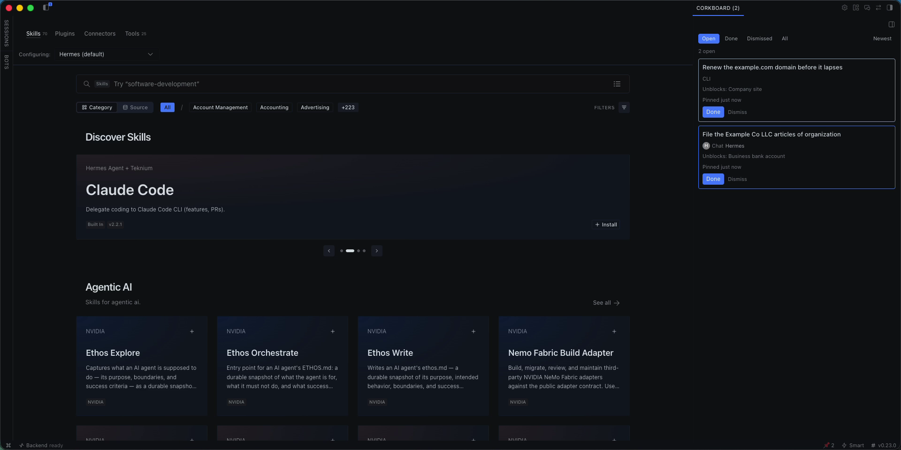
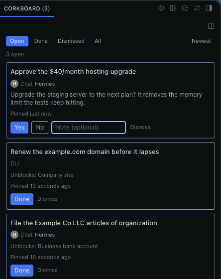
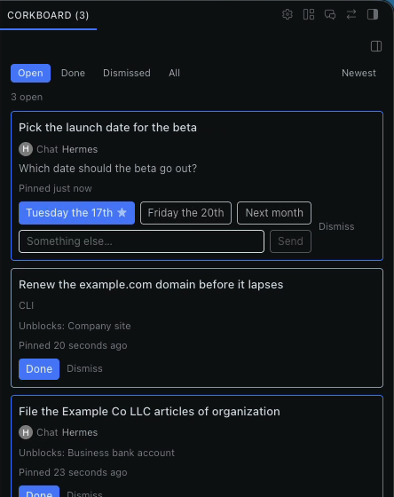
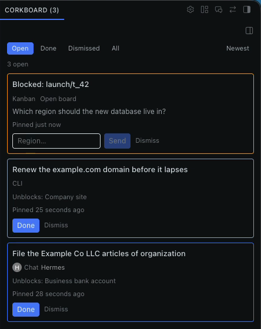
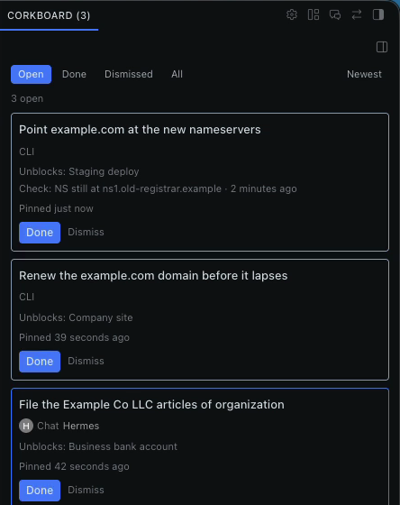
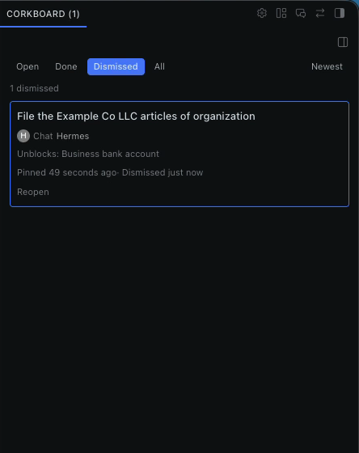

# corkboard

One place where agents pin **"only the owner can do this"** items — and where items clear
themselves when a check passes.

A native Hermes general plugin: one agent tool (`corkboard`), one CLI command
(`hermes corkboard`), one slash command (`/corkboard`), kanban auto-pin hooks, and a desktop
half (a sidebar page, a foldable side pane beside any view, and a status-bar badge) that
shares the same backend as the web dashboard.

Requires Hermes 0.21.6 or newer.



| Yes / no | Choice (recommendation starred) | Kanban card |
|---|---|---|
|  |  |  |

| Self-clearing check | Dismissed, with Reopen |
|---|---|
|  |  |

## What it does on your machine

Read this before installing.

- **One shared database for every profile.** Pins live in
  `~/.hermes/plugin-data/corkboard/data.db`, outside any single profile. Every profile with the
  plugin enabled reads and writes the same board. Pins hold titles, questions, answers, links and
  where each pin came from (a profile name, session id or board/task ref) — never message text
  and never credentials.
- **Commands it runs.** All with a timeout, none with a shell unless noted:
  - `dig +short NS <domain>` for DNS checks (agents and the owner can add these). This is a normal
    DNS lookup through your resolver.
  - `hermes kanban show|list … --json` to read card status, and `hermes kanban comment …` to post
    your answer to a blocked card as an `Owner decision:` comment (which resumes the worker).
  - **Owner-added shell checks.** `hermes corkboard add … --check-command "<cmd>"` stores a shell
    command that runs (via the shell, 5s timeout) whenever checks run, including from a cron job you
    set up. It runs without an approval prompt because only you can add it: the agent tool refuses
    `command` checks. Treat it like a line in your crontab.
- **When it runs.** DNS and shell checks run only on `hermes corkboard check` (by hand or from a
  cron job you add). On each kanban dispatch tick it reads blocked cards to clear finished kanban
  pins, and purges closed pins past the retention window. The plugin starts no background process
  and installs no cron job of its own.
- **Network.** None of its own beyond the DNS lookups above. No telemetry, no third-party
  services, no self-update.
- **Desktop.** The pane talks only to your Hermes backend through the plugin SDK. Colour
  preferences are stored per machine.

## Install

Clone or symlink this repo into `~/.hermes/plugins/corkboard/`, then enable it:

```bash
ln -s ~/src/hermes-corkboard ~/.hermes/plugins/corkboard
hermes plugins enable corkboard
```

Or add it to `config.yaml` directly:

```yaml
plugins:
  enabled:
    - corkboard
```

The desktop half ships in the same folder (`desktop/plugin.js` + `dashboard/plugin_api.py`).
Like every desktop plugin it is opt-in: enable it in **Capabilities → Plugins**. The backend
(`plugin_api.py`) loads only while `corkboard` is in `plugins.enabled` — that is the security
boundary, not a renderer toggle.

Enable the plugin in **each profile that should pin** — the default profile, the kanban worker,
the reviewer — not just the default. Only enabled profiles run their hooks and tools.

## Shared board (all profiles)

The board is one SQLite database shared by every Hermes profile. It lives at
`<hermes root>/plugin-data/corkboard/data.db` — that is `~/.hermes/plugin-data/corkboard/data.db`,
next to the `profiles/` directory, never inside one. The default (pre-profile) root is resolved on
every open, so a pin the worker creates shows up on the owner's desktop page and the CLI in the
default profile.

## Desktop

Two surfaces share one board: the **Corkboard** page (sidebar nav, `pin` icon, with its own
Close button) and a **side pane** docked to the right edge of the main workspace. The side pane
sits beside a chat, a Bot Mode bot chat, or the sessions view — it never replaces them. It starts
expanded (`defaultCollapsed: false`), 320px wide, and its tab title shows the live open-pin count
(`Corkboard (3)`).

The side pane's ✕ is never offered: `hideOnly: true` swaps Close for a fold (the header
minimize chevron, or the zone menu's Minimize row), so no close gesture can ever disable the
plugin. A folded pane keeps a rail tab and comes back on the next badge click.

Clicking the status-bar badge (an open-pin count, hidden while there are no open pins) reveals the
side pane through `host.revealPane('corkboard:side')`; desktops without that API fall back to
`host.navigate('/corkboard')`. The badge never focuses or navigates on background events.

The side pane's dock is a one-shot adoption hint (`dock: { pane: 'workspace', pos: 'right' }`,
no `enforce`), so dragging it elsewhere sticks across launches.

## Origin and link back

Every pin records where it came from: the chat it was pinned in (`session`), a Bot Mode bot
(`bot`), the kanban board (`kanban`), the CLI or slash command (`cli`), a markdown import
(`import`), or the dashboard API (`api`). Each pin shows an origin chip — **Chat**, **Bot**,
**Kanban**, **CLI**, **Imported**, or **API** — and a colour-coded card border. Only the origin
is stored (a profile name, a session id, a board/task ref); message text is never stored.

Where the origin can be re-opened, the board shows an **Open chat** / **Open board** button
(click-only, never automatic):

- **Chat** — `host.openSession(origin_session_id, { profile })`.
- **Bot** — resolved at click time by **name**, never a stored id: the profile's `canonical_session`
  (the "Bot Chat" registry row) is re-fetched from `profiles.list` and its live tip opened. A
  stored session id dangles after compression, so it is never used — the same rule the Bots
  roster enforces.
- **Kanban** — navigates to `/kanban` (the board page has no per-board/per-task deep link).
- **CLI / Import / API** — no button.

If an open fails (the chat was pruned, the profile is gone), the button turns into an inline
"Chat no longer available" and never throws. Bot chats also show the bot's avatar (fetched via
`profiles.get_asset`, cached per profile) or an initial-letter circle when there is no image.

The agent tool records the session id from the context Hermes injects into the handler — never
from the tool arguments — so an agent cannot point a pin at a chat it did not come from.

## Colours

Card border colours are configurable in **Settings → Plugins → Corkboard**. Defaults: chat =
blue, bot = violet, kanban = amber, CLI = slate, imported = teal, API = green. **Use each bot's
colour** (on by default) makes bot cards use that bot's own `profileColor` instead of violet.
Changes apply live without a reload. Preferences are per machine (`ctx.storage`).

## CLI

```bash
hermes corkboard                         # list open pins, newest first (default)
hermes corkboard list --status all --sort oldest
hermes corkboard add "File the LLC" --link https://… --unblocks "EIN"
hermes corkboard add "Nameservers"  --check-dns example.com=ns.cloudflare.com
hermes corkboard add "Nightly job"  --check-command "systemctl is-active cron"
hermes corkboard done <id>
hermes corkboard dismiss <id>
hermes corkboard answer <id> yes|no|"free text"
hermes corkboard check              # run every open check now
hermes corkboard purge [--dry-run]  # delete closed pins past the retention window
hermes corkboard import ./owner-corkboard.md                 # dig NS checks wait for ns.cloudflare.com
hermes corkboard import ./owner-corkboard.md --ns-suffix ns.example.net
```

`<id>` may be the full uuid or a unique prefix. The slash command takes the same status
filter: `/corkboard [open|done|dismissed|all]`.

## Retention

Done and dismissed pins leave the Open view immediately but stay on the board for
`retention_days` (default 30) so you can still see what was acknowledged and when. `0` keeps
closed pins forever. Purging runs opportunistically on list and on the dispatch tick, at most
once per hour, and always skips open pins.

```bash
hermes config set plugins.entries.corkboard.settings.retention_days 14
```


## Periodic checks (add yourself)

The plugin creates no cron of its own. To auto-clear checks, the owner adds one themselves:

```bash
hermes cron add "corkboard-check" --schedule "0 * * * *" -- hermes corkboard check
```

The morning digest target is **Telegram DM**; the plugin ships no cron for it. (Documented
here only; wire it up with `hermes cron` if you want it.)

## Agent rule

**Pin owner-only work instead of writing it in chat.** When a task is blocked on something
only the owner can do — a credential, a decision, a phone call, a payment — call the
`corkboard` tool with `action: "pin"` rather than leaving a message in the chat. The owner sees
every pin in one place and can answer it from the desktop page or the CLI.

## Secrets rule (hard)

No credentials in any pin. The tool refuses:

- values that look like tokens (long base64/hex, `sk-`, `ghp_`, `github_pat_`, AWS keys, …), and
- `text` pins whose question asks for keys / tokens / passwords / cards / CVC / API keys.

Credential needs are **`task` pins** that name the command the owner runs themselves (a secrets manager or the
tool's own login command), never a text box waiting for a secret.

## Kanban auto-pin

When a kanban card is blocked, `kanban_task_blocked` pins it as a `text` pin whose question is
the block reason and whose `reply_to` is the card. Answering the pin posts
`Owner decision: <answer>` as a comment on the card (a comment on a blocked card already
auto-resumes the worker). The pin clears on `kanban_task_completed` or, when the card is
unblocked but still running, on the next dispatch tick.

## Development

```bash
python3 -m pytest -q
node --check desktop/plugin.js
```

Tests run against a temp SQLite connection (stub `ctx`); they never touch `~/.hermes` or a real
board.
